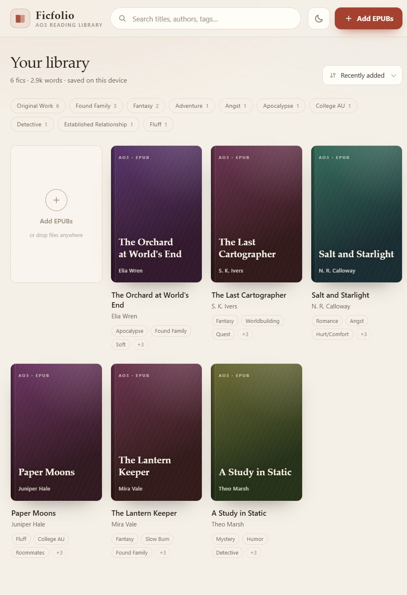
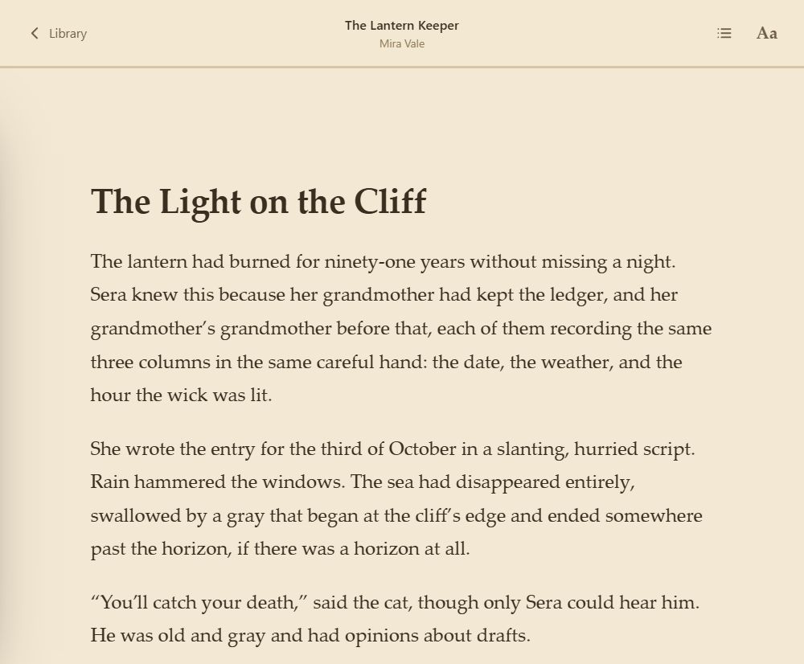

<div align="center">

# Ficfolio

**A local-first library and reader for AO3 EPUB downloads.**

Drop in your EPUBs, get a shelf of cards with titles, authors, and tags — then read each fic in a clean, distraction-free reader.

[](https://nodejs.org)
[](package.json)
[](LICENSE)

</div>

<p align="center">
  
</p>

## Overview

Ficfolio is a self-hosted web app for organizing Archive of Our Own EPUB exports. It reads the title, author, tags, summary, and chapter structure directly from each file, turns every fic into a browsable card, and opens it in a purpose-built reader.

Everything runs on your own computer: **no npm packages, no accounts, no cloud, and no external services.** The only runtime requirement is Node.js.

The project was built to explore the parts of a web app that normally get hidden behind libraries:

- reading the ZIP container and inflating entries with Node's `zlib`;
- parsing `container.xml`, OPF metadata, EPUB 3 navigation, and NCX without an XML package;
- sanitizing untrusted book HTML and rewriting internal links and images;
- building a fast, keyboard-friendly reader with vanilla JavaScript.

## Features

- **Import** — drag and drop anywhere on the page or use the file picker. Multiple EPUBs per upload, with SHA-256 duplicate detection.
- **Metadata extraction** — title, author, tags (`dc:subject`), summary, language, chapter count, and word count, read straight from the EPUB.
- **Cover art** — uses the EPUB's cover when present; otherwise generates deterministic gradient art from the title and author.
- **Library** — search across titles, authors, tags, and summaries; filter by tag; sort by recent, title, author, or chapter count.
- **Reader** — chapter drawer, previous/next navigation, progress bar, and automatic saving of your reading position.
- **Typography** — adjustable text size, line spacing, serif or sans typeface, and light, sepia, or dark page tones.
- **Responsive** — the library and reader adapt to phone-width screens.
- **Private by default** — the server binds to `127.0.0.1`; book files never leave your machine.
- **Zero dependencies** — no install step, no build step, no framework.

<p align="center">
  
</p>

## Quick start

### Requirements

- [Node.js](https://nodejs.org) 18 or newer
- A modern browser

Works on Windows, macOS, and Linux. No `npm install` is needed.

### Run

```bash
git clone https://github.com/Jellyyfishh329/ficfolio.git
cd ficfolio
npm start
```

Open **http://localhost:4545**.

Press `Ctrl+C` in the terminal to stop the server.

Or choose **Code → Download ZIP** on GitHub, extract the folder, and run `npm start` inside it.

## Usage

### Import fics

1. Export a fic from AO3 as an EPUB.
2. Open Ficfolio and click **Add EPUBs**, or drag one or more files anywhere onto the page.
3. Each fic appears as a card with its title, author, and top tags.
4. Uploading the same file again is detected and skipped.

The repository ships without any books, so the library starts empty.

### Read

Click a card to open the reader. Choose a chapter from the list, use the previous/next buttons, or scroll. Ficfolio remembers your position in each fic and restores it next time.

The **Aa** button opens reading settings for text size, line spacing, typeface, and page tone.

### Manage

- Use the search field to narrow the library by title, author, tag, or summary.
- Click a tag chip to filter; click it again to clear the filter.
- Hover a card and click the trash icon to remove the extracted copy. Removing a fic never touches your original EPUB download.
- If port `4545` is busy:

```bash
$env:PORT=5000; npm start      # PowerShell
PORT=5000 npm start            # macOS / Linux
```

### Keyboard shortcuts

| Key | Action |
| --- | --- |
| `/` | Focus search |
| `←` / `→` | Previous / next chapter |
| `Space` / `PageUp` / `PageDown` | Scroll |
| `Esc` | Close settings, chapter list, or reader |

## How it works

### Architecture

```text
┌───────────────────────────┐       HTTP + JSON        ┌──────────────────────────┐
│  Browser — public/        │  ◄───────────────────►   │  Node — server.js        │
│  cards · search · reader  │                          │  ZIP → XML → sanitize    │
└─────────────┬─────────────┘                          └────────────┬─────────────┘
              │ localStorage                                        │ fs
              ▼                                                     ▼
   theme · position · settings                        data/library/<book-id>/
```

The backend is a single `server.js` with no third-party code. The frontend is plain HTML, CSS, and JavaScript in `public/`.

### Import pipeline

1. The browser POSTs the raw EPUB bytes to `/api/books` with an `X-Filename` header.
2. The server reads the body up to 250 MB, computes a SHA-256 hash, and rejects duplicates.
3. `unzip()` locates the end-of-central-directory record, walks the central directory, and inflates each entry with `zlib.inflateRawSync`.
4. `parseEpub()` follows `META-INF/container.xml` to the OPF package document, then builds the manifest, spine, chapter titles, tags, summary, and word count. EPUB 3 `nav` is preferred, with NCX as a fallback.
5. Files are written to a temporary directory and atomically renamed into `data/library/<book-id>/`, so an interrupted import never leaves a half-book behind.
6. Metadata is stored in `meta.json`; chapter paths live in `chapters.json`.

Non-linear spine items (such as some cover pages) are excluded from the chapter list.

### Chapter rendering

When a chapter is requested:

- the XHTML body is extracted and passed through a server-side allowlist sanitizer;
- relative asset URLs are rewritten to `/api/books/<id>/assets/...`;
- internal links to other chapters are converted into reader navigation;
- the browser sanitizes the markup again before inserting it, as defense in depth.

Assets are served only from inside the fic's `files/` directory, with path-traversal checks on every request.

### Frontend

`public/app.js` handles rendering, uploads, drag and drop, filtering, sorting, hash routing (`#/read/<book-id>`), chapter caching, and reader state. Theme, typography, and reading positions live in `localStorage`; the library itself lives on disk.

## API

All responses are JSON unless noted. Errors return `{ "error": "message" }`.

| Method | Path | Description |
| --- | --- | --- |
| `GET` | `/api/books` | List all books with metadata |
| `POST` | `/api/books` | Import an EPUB from the raw request body; send the filename in `X-Filename`. Returns `201`, or `200` with `duplicate: true` |
| `GET` | `/api/books/:id` | Read one book's metadata |
| `DELETE` | `/api/books/:id` | Delete a book and its extracted files |
| `GET` | `/api/books/:id/chapters/:index` | Get a sanitized chapter and its navigation context |
| `GET` / `HEAD` | `/api/books/:id/assets/*` | Serve images, styles, and other book assets |

Upload limit: 250 MB per file. Unsupported or malformed EPUBs return `400`; unknown routes return `404`.

## Data and privacy

### Storage layout

```text
data/
└─ library/
   └─ <slug>-<hash8>/
      ├─ meta.json        # title, author, tags, counts, cover path
      ├─ chapters.json    # ordered chapter titles and file paths
      └─ files/           # extracted EPUB contents
```

The uploaded EPUB archive itself is not retained; Ficfolio stores the extracted book. `data/` is git-ignored, so a clone never contains someone else's library.

### What persists

- **Library** — on disk, across page reloads, server restarts, and reboots.
- **Reading position, theme, typeface, spacing** — in the browser's `localStorage`, per browser profile.
- **Original EPUB downloads** — untouched wherever you saved them.

To reset the library, stop the server and delete `data/library`.

## Project structure

```text
ficfolio/
├─ public/
│  ├─ index.html      # app shell, library, and reader markup
│  ├─ styles.css      # themes, cards, reader typography, responsive rules
│  └─ app.js          # rendering, uploads, routing, reader behavior
├─ docs/
│  ├─ library.jpg
│  └─ reader.jpg
├─ server.js          # ZIP reader, EPUB parser, sanitizer, API, static server
├─ package.json       # npm start; Node >=18
├─ LICENSE
└─ README.md
```

## Limitations

- ZIP64 and encrypted EPUBs are not supported; AO3 exports use neither.
- Search covers metadata, not the full text of chapters.
- One library, one user, no authentication. It is designed to run locally and should not be exposed to the internet as-is.
- EPUBs that rely on unusual layout or scripting may render only their text content; scripts are stripped.

## Development

There is no build step. Edit files in `public/` or `server.js` and reload the page; restart the server after backend changes.

```bash
npm start          # http://localhost:4545
node --check server.js
```

The library is intentionally empty in the repository. Add your own EPUBs, or delete `data/library` to start over.

## License

Released under the [MIT License](LICENSE).

## Disclaimer

Ficfolio is an unofficial personal project and is not affiliated with Archive of Our Own. Downloaded works remain the property of their authors; this tool only stores copies you already chose to download. Please respect authors' rights and AO3's terms of service.
